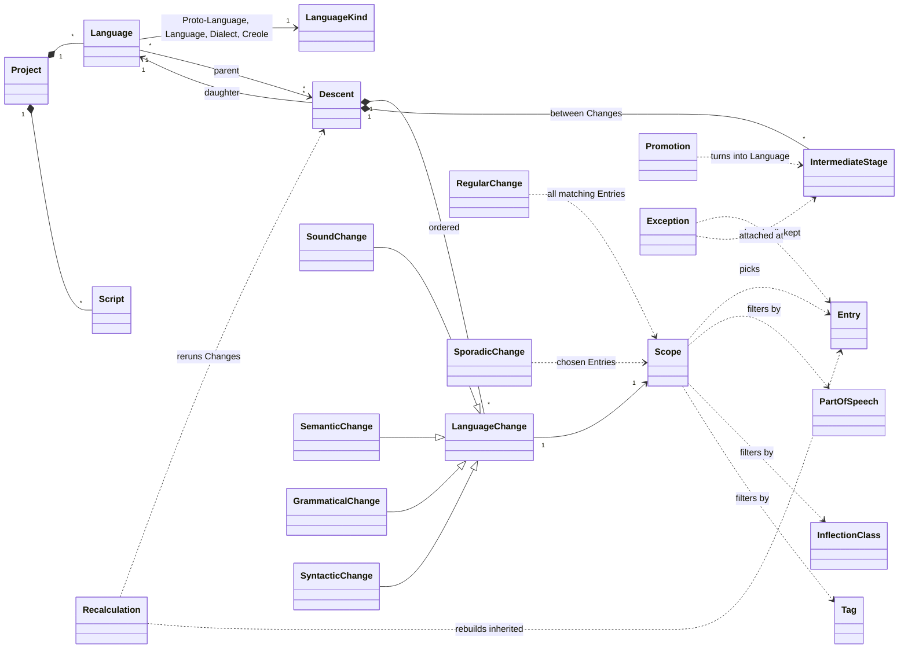
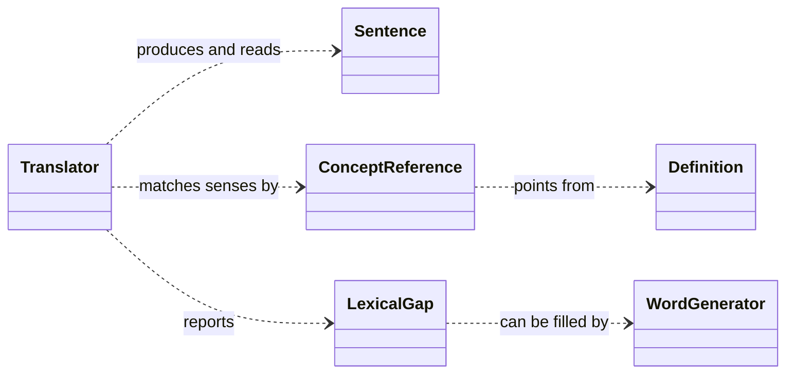
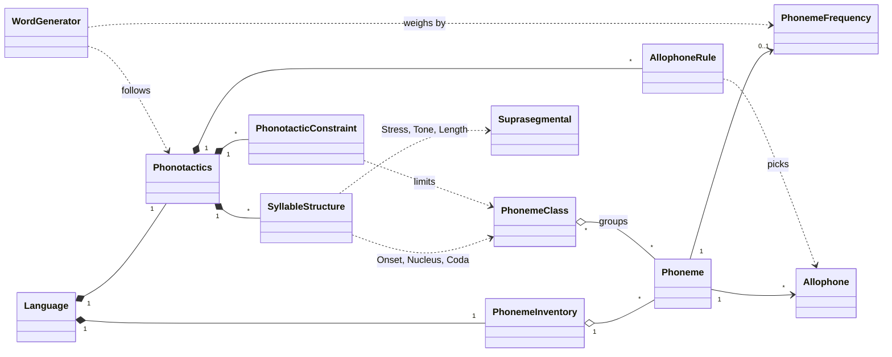
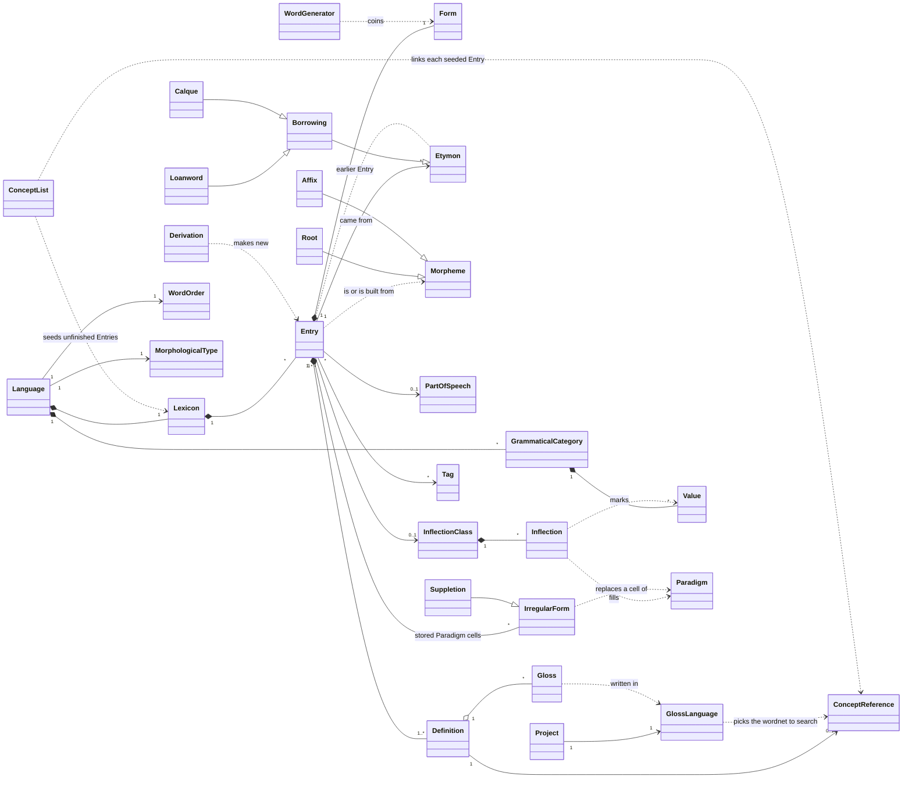
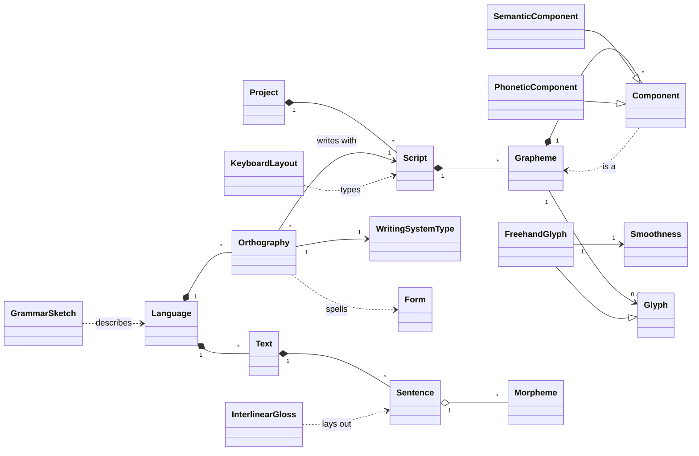

# Domain Diagram

How the terms in `CONTEXT.md` relate to each other.
It's split into four diagrams by area, because one big diagram is too much for Mermaid to lay out.
Class names are the glossary terms with the spaces removed.

Update this whenever `CONTEXT.md` changes.

## Projects and change

## Translation

## Sounds

## Words and grammar

## Writing and texts

